<p align="center">
  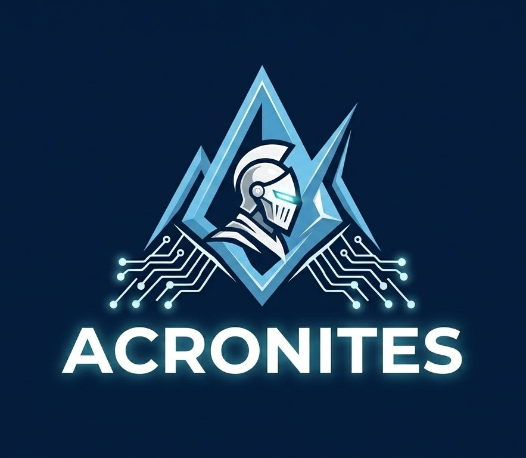
</p>

<h1 align="center">DepthWizard</h1>

<p align="center">
  <strong>Single-view satellite imagery to metric elevation and immersive 3D terrain</strong>
</p>

<p align="center">
  An end-to-end geospatial reconstruction system that transforms georeferenced and
  non-georeferenced optical imagery into elevation products and navigable 3D scenes—without LiDAR input or OSM building geometry.
</p>

<p align="center">
  <a href="https://www.sih.gov.in/"></a>
  
  
  
  
</p>

---

## Important links

| Resource | Link |
| :---: | :---: |
| 🚀 **Live demo** | [Launch DepthWizard](https://depthwizard.aritra-projects.com/) |
| 🎬 **Demo video** | [Watch the complete walkthrough](https://youtu.be/E1muugqlmSc) |
| 📘 **Technical documentation** | [Read the technical report](https://drive.google.com/file/d/1fASZx6CBKb_z7G6r1q9pZRpXJZtNvUXi/view?usp=sharing) |
| 💻 **Source code** | [View the GitHub repository](https://github.com/programmer1128/DepthWizard) |

---

## Results

DepthWizard selects an appropriate reconstruction path for urban, mountainous,
forested, and sparse scenes while preserving the source image as the visual texture.
The following comparisons show the original 2D optical input beside the generated 3D scene.

### 🏙️ Urban reconstruction

<table>
  <tr>
    <th width="50%">2D optical input</th>
    <th width="50%">DepthWizard 3D reconstruction</th>
  </tr>
  <tr>
    <td align="center">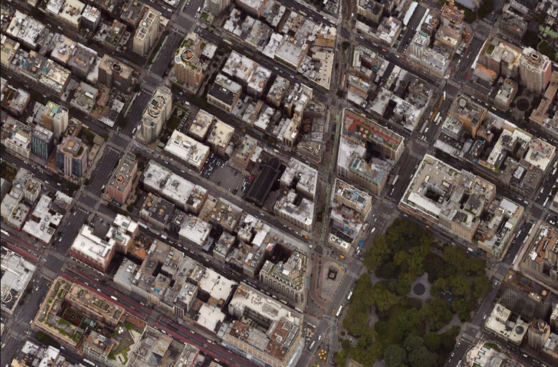<br><sub><b>New York City</b> · Dense urban scene</sub></td>
    <td align="center"><br><sub>LoD2 buildings with orthophoto roofs and generated facade materials</sub></td>
  </tr>
  <tr>
    <td align="center">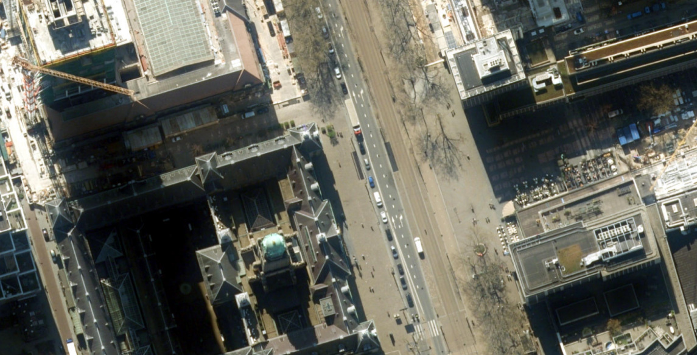<br><sub><b>Rotterdam</b> · Mixed urban morphology</sub></td>
    <td align="center">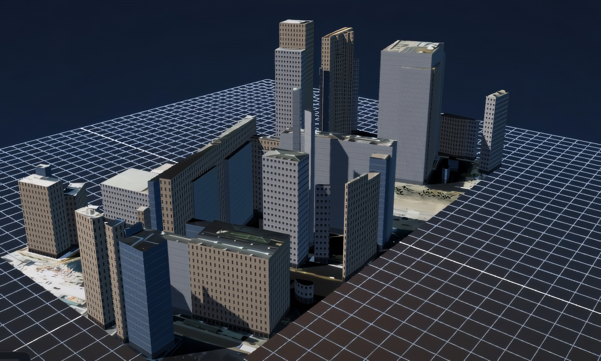<br><sub>Geometrically regularized building reconstruction</sub></td>
  </tr>
  <tr>
    <td align="center">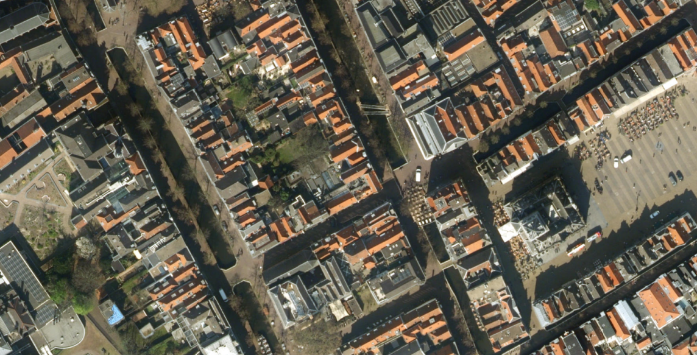<br><sub><b>Delft Old Town</b> · Compact historic fabric</sub></td>
    <td align="center">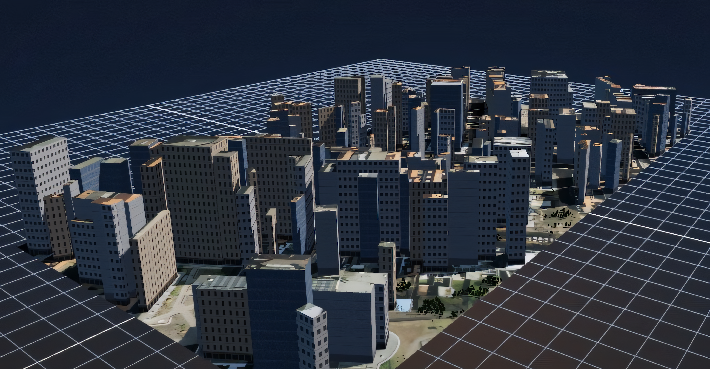<br><sub>Textured roofs with footprint-aware extrusion</sub></td>
  </tr>
</table>

### ⛰️ Mountain and natural terrain

<table>
  <tr>
    <th width="50%">2D optical input</th>
    <th width="50%">DepthWizard 3D reconstruction</th>
  </tr>
  <tr>
    <td align="center"><br><sub><b>Atlas Mountains</b></sub></td>
    <td align="center">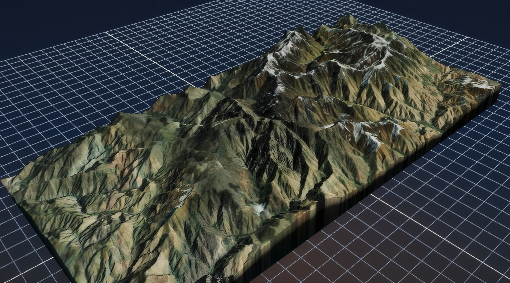<br><sub>Elevation-displaced, optical-textured terrain</sub></td>
  </tr>
  <tr>
    <td align="center">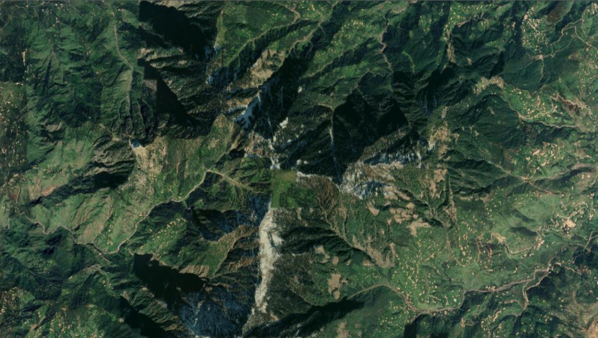<br><sub><b>Manali</b></sub></td>
    <td align="center">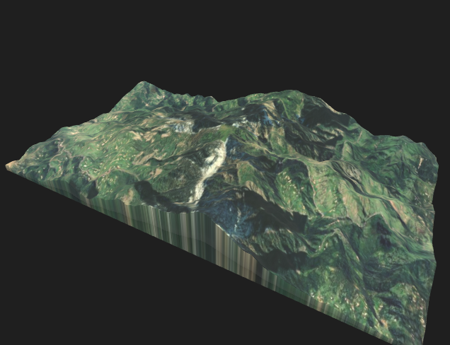<br><sub>High-relief terrain reconstruction</sub></td>
  </tr>
  <tr>
    <td align="center"><br><sub><b>Wengen</b></sub></td>
    <td align="center">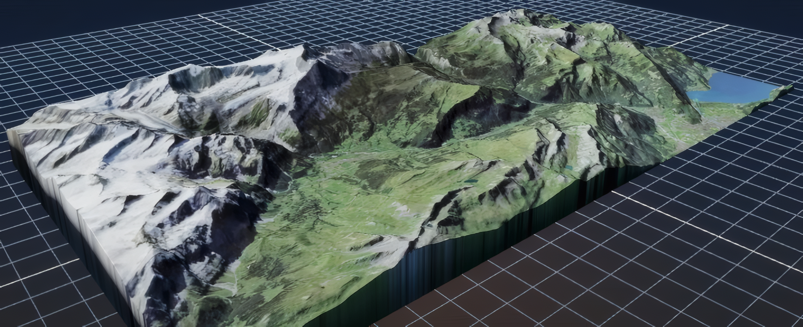<br><sub>Continuous mountain surface with optical projection</sub></td>
  </tr>
</table>

### 🌲 Forest and canopy reconstruction

<table>
  <tr>
    <th width="50%">2D optical input</th>
    <th width="50%">DepthWizard 3D reconstruction</th>
  </tr>
  <tr>
    <td align="center"><br><sub><b>Western Ghats</b> · Dense vegetation</sub></td>
    <td align="center"><br><sub>Terrain-following canopy and forest assets</sub></td>
  </tr>
  <tr>
    <td align="center">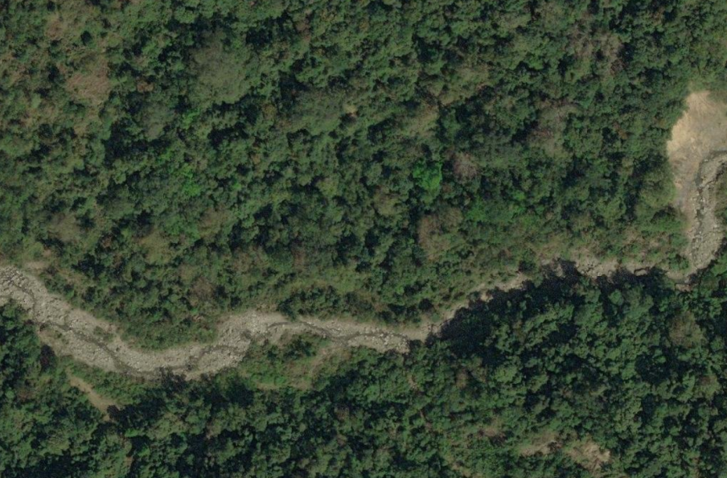<br><sub><b>Arunachal Pradesh</b> · Forested relief</sub></td>
    <td align="center"><br><sub>Forest-aware presentation with preserved terrain structure</sub></td>
  </tr>
</table>

### 🌾 Sparse vegetation

<table>
  <tr>
    <th width="50%">2D optical input</th>
    <th width="50%">DepthWizard 3D reconstruction</th>
  </tr>
  <tr>
    <td align="center">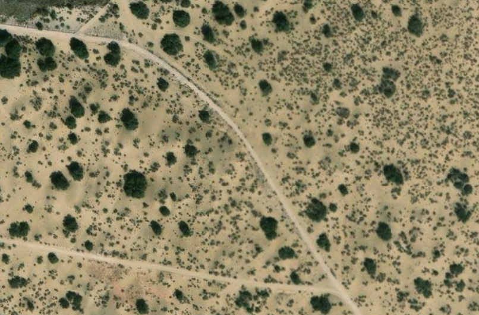<br><sub><b>Thar Desert</b> · Sparse settlement and vegetation</sub></td>
    <td align="center">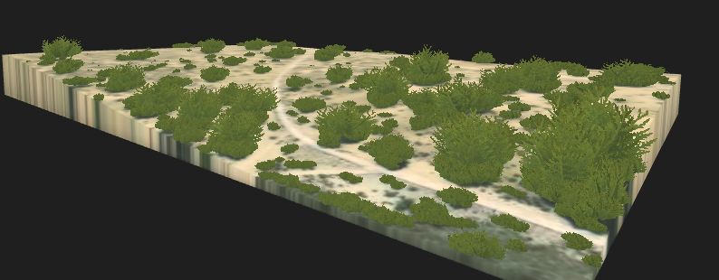<br><sub>Sparse vegetation assets placed without modifying terrain or buildings</sub></td>
  </tr>
</table>

> [!NOTE]
> Add the acquisition source, ground sampling distance, crop size, and render settings for every published result. This makes the visual comparison reproducible and defensible.

---

## Benchmarking

DepthWizard evaluates generated absolute Digital Surface Models against
**OpenTopography COP30** reference elevations. The comparison pipeline aligns
the reference data to the optical grid and reports RMSE, MAE, Pearson
correlation, and the project accuracy score across four landscape typologies.

### ⛰️ Hilly and mountainous regions

| Location | Estimated height | Reference height | RMSE ↓ | MAE ↓ | Pearson ↑ | Accuracy ↑ |
| :--- | ---: | ---: | ---: | ---: | ---: | ---: |
| Wengen Slope, Switzerland | 1294.41 m | 1294.41 m | 1.19 m | 0.34 m | 1.0000 | 95.72% |
| Interlaken Hills, Switzerland | 1980.12 m | 1984.18 m | **0.96 m** | 0.36 m | 1.0000 | **96.17%** |
| Atlas Mountains, Morocco | 3159.70 m | 3158.06 m | 3.03 m | 1.72 m | 1.0000 | 73.14% |

### 🏙️ Urban areas

| Location | Estimated height | Reference height | RMSE ↓ | MAE ↓ | Pearson ↑ | Accuracy ↑ |
| :--- | ---: | ---: | ---: | ---: | ---: | ---: |
| Rotterdam Centre, Netherlands | 3.48 m | 3.47 m | 1.03 m | 1.72 m | 0.95 | **99.71%** |
| Delft Old Town, Netherlands | 7.26 m | 5.46 m | 1.03 m | **1.06 m** | 0.89 | 65.78% |
| New York City, USA | 174.57 m | 174.32 m | **1.01 m** | 1.56 m | **0.90** | 90.89% |

### 🌾 Sparse regions

| Location | Estimated height | Reference height | RMSE ↓ | MAE ↓ | Pearson ↑ | Accuracy ↑ |
| :--- | ---: | ---: | ---: | ---: | ---: | ---: |
| Rajasthan (Thar Desert), India | 10.57 m | 10.46 m | 1.03 m | 0.72 m | **1.0000** | 76.89% |
| Sierre, Switzerland | 512.45 m | 511.10 m | 1.68 m | 1.12 m | 0.9912 | 78.40% |
| Death Valley, USA | -85.12 m | -85.24 m | **0.78 m** | **0.45 m** | 0.8240 | **89.65%** |

### 🌲 Forest and canopy regions

| Location | Estimated height | Reference height | RMSE ↓ | MAE ↓ | Pearson ↑ | Accuracy ↑ |
| :--- | ---: | ---: | ---: | ---: | ---: | ---: |
| Western Ghats (Silent Valley), India | 410.79 m | 401.72 m | 5.19 m | 4.06 m | **0.9959** | 33.30% |
| Florida Forest, USA | 27.00 m | 26.10 m | **1.40 m** | **1.20 m** | 0.92 | 65.30% |
| Black Forest, Germany | 1050.00 m | 1058.25 m | 1.67 m | 1.57 m | 0.85 | **70.30%** |

### Global weighted aggregate

The aggregate uses sample-size spatial weighting across all evaluated pixels.

| Benchmark | Evaluation extent | RMSE ↓ | MAE ↓ | Pearson ↑ |
| :--- | :--- | ---: | ---: | ---: |
| **Global weighted benchmark** | 12 landscape typologies, more than 10⁷ evaluated pixels | **1.83 m** | **1.32 m** | **0.94** |

> [!IMPORTANT]
> “Accuracy” is reproduced exactly from the project technical documentation.
> Before external publication, document its formula and threshold explicitly so
> that readers can reproduce the percentage independently.

---

## Technology stack

<p align="center">
  
  
  
  
</p>

<p align="center">
  
  
  
  
</p>

<p align="center">
  
  
  
  
</p>

<p align="center">
  
  
  
  
</p>

| Layer | Technologies | Responsibility |
| :--- | :--- | :--- |
| **AI and remote-sensing models** | PyTorch, GAMUS-tuned Depth Anything V2, semantic segmentation, Modal GPU | Relative/metric height features and land-cover semantics |
| **Backend API and orchestration** | C++20, Drogon, CMake, OpenMP, libcurl | Asynchronous ingestion, inference orchestration and scene generation |
| **Geospatial processing** | GDAL/OGR + GEOS, Eigen | GeoTIFF I/O, reprojection, affine transforms and raster alignment |
| **Vision and geometry** | OpenCV, CGAL, Halide | Masks, morphology, footprint regularization and terrain computation |
| **Building reconstruction** | SAT2LoD2, custom height estimation and UV mapping | LoD2 building geometry with source-aligned roof textures |
| **3D packaging** | glTF/GLB, Draco | Compact, browser-ready terrain, building and vegetation assets |
| **Frontend** | Three.js, Vite, MapLibre GL, 3D Tiles Renderer | Interactive flythrough, inspection and geospatial visualization |
| **Storage** | MinIO, AWS SDK for C++ (S3) | Private storage for GLBs and raster exports |
| **Deployment** | NGINX, systemd, Ubuntu Linux | Reverse proxy, static hosting and resilient backend services |

---

## Run the codebase by module

### Repository layout

```text
DepthWizard/
├── Elevation_Estimation_Module/
│   └── gis_service/                 # C++20/Drogon backend and reconstruction engine
├── frontend_service/                # Vite + Three.js interactive viewer
├── Model_Training_Scripts/          # Training and evaluation notebooks/scripts
└── README.md
```

### Prerequisites

- Ubuntu 22.04 or 24.04
- GCC/G++ with C++20 support
- CMake, Git and pkg-config
- Node.js 20+ and npm
- MinIO server
- Drogon, Draco, AWS SDK for C++ (`s3`), and Halide
- GDAL built with GEOS support

Install the distribution-provided dependencies:

```bash
sudo apt update
sudo apt install -y \
  build-essential cmake git pkg-config \
  libgdal-dev gdal-bin libgeos-dev \
  libcurl4-openssl-dev libssl-dev zlib1g-dev uuid-dev \
  libjsoncpp-dev libeigen3-dev libopencv-dev libcgal-dev libomp-dev
```

> Drogon, Draco, AWS SDK for C++ and Halide may need to be installed from source or official release packages. See [`Elevation_Estimation_Module/gis_service/deploy/README.md`](Elevation_Estimation_Module/gis_service/deploy/README.md) for the production deployment procedure.

### 1. Clone the repository

```bash
git clone https://github.com/programmer1128/DepthWizard.git
cd DepthWizard
```

Run the remaining commands from the repository root unless a section says to
use a separate terminal.

### 2. Object-storage module — MinIO

The backend stores generated GLBs and raster exports in a private S3-compatible bucket.

```bash
mkdir -p .local/minio-data

export MINIO_ROOT_USER="REPLACE_WITH_LOCAL_ACCESS_KEY"
export MINIO_ROOT_PASSWORD="REPLACE_WITH_LOCAL_SECRET_KEY"

minio server .local/minio-data \
  --address 127.0.0.1:9000 \
  --console-address 127.0.0.1:9001
```

Keep this terminal running. The local MinIO console is available at
`http://127.0.0.1:9001`.

### 3. Backend module — elevation and 3D reconstruction

In a second terminal:

```bash
cd Elevation_Estimation_Module/gis_service

cp deploy/secrets.env.example deploy/secrets.env
```

Fill `deploy/secrets.env` without committing it:

```dotenv
OPENTOPOGRAPHY_API_KEY=REPLACE_IF_USING_REFERENCE_COMPARISON
DEPTHWIZARD_MINIO_ENDPOINT=127.0.0.1:9000
DEPTHWIZARD_MINIO_ACCESS_KEY=REPLACE_WITH_LOCAL_ACCESS_KEY
DEPTHWIZARD_MINIO_SECRET_KEY=REPLACE_WITH_LOCAL_SECRET_KEY
```

Build and run:

```bash
./deploy/scripts/build_backend.sh
cd build-release
./gis_service
```

The service reads `deploy/secrets.env` and the validated
`deploy/depthwizard.env` automatically. Test it with:

```bash
curl http://127.0.0.1:8081/api/v1/ping
```

If Halide is installed in a non-standard prefix, configure CMake explicitly:

```bash
cmake -S . -B build-release \
  -DCMAKE_BUILD_TYPE=Release \
  -DBUILD_TESTING=OFF \
  -DHalide_DIR=/path/to/halide/lib/cmake/Halide

cmake --build build-release --parallel --target gis_service
```

### 4. Frontend module — interactive Three.js viewer

In a third terminal:

```bash
cd frontend_service
npm ci
npm run dev
```

Open `http://127.0.0.1:5173`. Vite automatically proxies `/api` requests to
the backend at `http://127.0.0.1:8081`.

To point the development frontend at another backend:

```bash
DEPTHWIZARD_BACKEND_URL=http://SERVER_ADDRESS:8081 npm run dev
```

### 5. Model training and evaluation module

The production checkpoints are used by the hosted inference services. The
training notebooks and the local baseline harness are retained for reproducibility:

```bash
cd Model_Training_Scripts
python3 -m venv .venv
source .venv/bin/activate
python -m pip install --upgrade pip
python -m pip install jupyterlab

# Install the versions required by the selected notebook/environment,
# then launch Jupyter or run the baseline harness.
jupyter lab
```

Available entry points include:

```text
baseline_harness.py
dav2-traina-cls-1.ipynb
dav2-trainb-cls-1.ipynb
dav2-trainc-cls-1.ipynb
```

### 6. Run tests

Backend:

```bash
cd Elevation_Estimation_Module/gis_service
cmake -S . -B build-tests -DCMAKE_BUILD_TYPE=Release -DBUILD_TESTING=ON
cmake --build build-tests --parallel
ctest --test-dir build-tests --output-on-failure
```

Frontend:

```bash
cd frontend_service
npm ci
npm test
npm run build
```

### 7. Test a GeoTIFF end to end

```bash
curl -X POST http://127.0.0.1:8081/api/v1/processor \
  -F "image=@/absolute/path/to/test-image.tif"
```

The response includes a job UUID and a relative `/api/v1/download/...` URL
for the reconstructed GLB and generated raster products.

---

## How it works

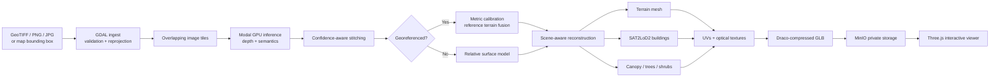

### Supported output behavior

| Input | Elevation product | 3D behavior |
| :--- | :--- | :--- |
| Georeferenced GeoTIFF | Metric DSM and derived raster exports | Metric terrain, LoD2 buildings and vegetation-aware scene |
| PNG/JPG without spatial metadata | Relative DSM | Relative 3D reconstruction and visualization |
| Bounding box | Sentinel-2 optical GeoTIFF followed by reconstruction | Best suited to terrain and forest because Sentinel-2 is 10 m/pixel |

---

## API overview

| Method | Endpoint | Purpose |
| :---: | :--- | :--- |
| `GET` | `/api/v1/ping` | Health check |
| `POST` | `/api/v1/processor` | Process a georeferenced GeoTIFF (`image` multipart field) |
| `POST` | `/api/v1/processor/normal-image` | Process a non-georeferenced JPG/PNG |
| `POST` | `/api/v1/global-map/geotiff` | Fetch and process imagery for a bounding box |
| `GET` | `/api/v1/download/{file}` | Download generated GLBs and raster products |
| `GET` | `/api/v1/processor/exports/{uuid}` | Inspect raster-export status |
| `POST` | `/api/height/single` | Query height at one location |
| `POST` | `/api/height/compare` | Compare estimated and reference heights |

---

## Data, attribution and responsible use

- Bounding-box imagery uses Copernicus Sentinel-2 L2A data from the public Earth Search catalogue and AWS open-data bucket.
- Reference elevation may use OpenTopography and other configured DEM providers; their individual terms and attribution requirements apply.
- Bundled vegetation assets and their licences are documented under [`Elevation_Estimation_Module/gis_service/assets/vegetation/`](Elevation_Estimation_Module/gis_service/assets/vegetation/).
- DepthWizard does not require OSM building geometry for reconstruction.
- Validate estimated elevation against authoritative survey data before safety-critical, military, engineering, or emergency-response use.

---

## Team

<table>
  <tr>
    <th>Member</th>
    <th>Role</th>
    <th>Profile</th>
  </tr>
  <tr>
    <td>REPLACE_MEMBER_1</td>
    <td>REPLACE_ROLE</td>
    <td><a href="REPLACE_PROFILE_URL">Profile</a></td>
  </tr>
  <tr>
    <td>REPLACE_MEMBER_2</td>
    <td>REPLACE_ROLE</td>
    <td><a href="REPLACE_PROFILE_URL">Profile</a></td>
  </tr>
</table>

---

<p align="center">
  Built for the Smart India Hackathon · <strong>DepthWizard</strong>
</p>
